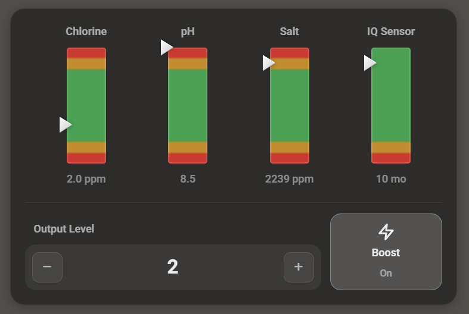

# Spa Monitor Card

Home Assistant Lovelace card for HotSpring/ESP-IQ2020 water quality monitoring with vertical bar gauges, triangle indicators, and integrated salt system controls.

Fork of [pool-monitor-card](https://github.com/wilsto/pool-monitor-card) by [wilsto](https://github.com/wilsto), redesigned for salt water care systems.



Screenshot from the published v0.1.1; the current fixes retain that layout.

---

## Features

- **Vertical bar gauges** with color-coded gradients (red/yellow/green zones)
- **3D triangle indicators** positioned by current sensor value
- **Salt system controls**: bounded output stepper and acknowledged Boost on/off requests
- **4 theme modes**: auto, light, dark, and glass (visionOS-style)
- **Visual config editor** with entity pickers (no YAML required)
- **Glassmorphism design** with backdrop blur and translucent surfaces
- **Fully customizable** via CSS custom properties and card-mod

---

## Installation

### HACS (recommended)

1. Open [HACS](https://hacs.xyz/) > Frontend > three-dot menu > Custom repositories
2. Add `https://github.com/JoeQuantum/spa-monitor-card` with category **Plugin**
3. Search for **Spa Monitor Card**, install, and reload your browser

### Manual

1. Download `spa-monitor-card.js` from the [latest release](https://github.com/JoeQuantum/spa-monitor-card/releases)
2. Copy to `config/www/spa-monitor-card/spa-monitor-card.js`
3. Add resource in Settings > Dashboards > Resources:
   - URL: `/local/spa-monitor-card/spa-monitor-card.js`
   - Type: JavaScript Module

---

## Configuration

The card includes a **visual config editor** for title, theme and entity selection.
The starter uses `sensor.replace_with_spa_ph`; select your own entity before use.
It intentionally selects no real device when several spas may be present. Advanced
ranges, units and conversion options use YAML and survive editor changes.
The entity IDs below are illustrative, not discovered or verified Aria mappings.
Confirm your ESP-IQ2020 entities and units, especially the source of the salt value.

### Full example

```yaml
type: custom:spa-monitor-card
title: Water Quality
theme: auto
sensors:
  chlorine:
    entity: sensor.hot_tub_iq_chlorine
  ph:
    entity: sensor.hot_tub_iq_ph
  salt:
    entity: sensor.hot_tub_iq_salt
  iq_sensor:
    entity: sensor.hot_tub_iq_hours_left
controls:
  output_level:
    entity: number.hot_spring_aria_salt_power
  boost:
    entity: switch.hot_spring_aria_salt_boost
```

### Card options

| Option | Type | Default | Description |
|--------|------|---------|-------------|
| `title` | string | *(none)* | Card title. Omit to hide the header row. |
| `theme` | string | `auto` | `auto`, `light`, `dark`, or `glass`. See [Themes](#themes). |
| `sensors` | object | **required** | At least one sensor must be defined. |
| `controls` | object | *(none)* | Optional salt system controls. Omit to hide the controls row. |

### Predefined sensors

The four sensors below have built-in defaults. Just provide an `entity` and the rest is filled in automatically.

| Sensor ID | Name | Unit | Min | Max | Green Range | Gradient | Display Format |
|-----------|------|------|-----|-----|-------------|----------|----------------|
| `chlorine` | Chlorine | ppm | 0 | 10 | 1.0 – 5.0 ppm | standard | numeric |
| `ph` | pH | *(none)* | 6.0 | 9.0 | 7.2 – 7.8 | standard | numeric |
| `salt` | Salt | ppm | 1000 | 3000 | 1500 – 2000 ppm | standard | numeric |
| `iq_sensor` | IQ Sensor | hours | 508 | 10000 | 1969+ hours (~2+ mo) | depletion | hours_to_months |

The chemistry target bands retain the project's FreshWater reference ranges.
Other breakpoints, bar proportions and the IQ countdown bands are project display
choices. A green band is not proof of water safety or sensor health. The IQ reserve
is based on owner observations, not a universal manufacturer expiry threshold.
See [preset provenance](docs/range-provenance.md) for manual editions, PDF pages,
units, owner reports and the distinction between documented ranges and display choices.

### Per-sensor options

Any preset default can be overridden:

```yaml
sensors:
  chlorine:
    entity: sensor.hot_tub_iq_chlorine
    name: "Free Cl"
    unit: "ppm"
    min: 0
    max: 10
    decimals: 1
    gradient: standard
    display_format: null
```

| Option | Type | Description |
|--------|------|-------------|
| `entity` | string | **Required.** A `sensor.*` entity ID. It need not be loaded when configuration is saved. |
| `name` | string | Override the display label above the bar. |
| `unit` | string | Override the unit shown after the value. |
| `min` | number | Finite lower bound, less than `max`; see scale overrides below. |
| `max` | number | Finite upper bound, greater than `min`; see scale overrides below. |
| `decimals` | integer | Decimal places, 0–100 (default varies by sensor). |
| `gradient` | string | `standard` (red-yellow-green-yellow-red) or `depletion` (green-yellow-red). |
| `display_format` | string or null | `numeric` or `null` shows the number; `hours_to_months` shows an estimated month count. |
| `zones` | array or null | Ordered value/position breakpoints; `null` explicitly selects a linear min/max scale. |
| `hours_reserve` | number | Hours subtracted from the value before the months conversion. Defaults to `0`; the `iq_sensor` preset uses an owner-reported `508`-hour reserve, configurable for your installation. |
| `hours_per_month` | number | Divisor used by `hours_to_months`. Defaults to `730.5` (365.25 × 24 / 12). |

#### display_format: hours_to_months

The `hours_to_months` format computes `max(0, (value − hours_reserve) / hours_per_month)` and rounds to the nearest integer. This is the default for the `iq_sensor` preset.

`hours_per_month` must be a finite number greater than zero, and `hours_reserve`
must be a finite nonnegative number. Invalid options produce a field-specific
configuration error. Malformed or nonfinite sensor states show `---` without a
marker; numeric zero remains a valid reading.

Two owners reported IQ monitoring stopping with 508 hours still displayed:
[first report](https://github.com/Ylianst/ESP-IQ2020/issues/42#issuecomment-3287918736)
and [second report](https://github.com/Ylianst/ESP-IQ2020/issues/42#issuecomment-3324424968).
The preset retains this configurable reserve. The calculation gives about 13
average months from 10,000 raw hours; it is not a guaranteed calendar service life.
A rounded `0 mo` does not by itself establish expiry. The gauge tooltip and
accessible description retain raw hours and identify the displayed month estimate.
This measuring sensor is distinct from the chlorine-generating salt cartridge.

#### Validation and scale overrides

`sensors` must be a nonempty object; each sensor and optional control must be an
object. Entities use `sensor.*`, `number.*` for output, and `switch.*` for Boost.
Known options are checked before the card is rendered, including options supplied
while their display format is inactive. Errors identify the YAML field. Unknown
extension fields on the card, sensors and supported controls are preserved.

A custom sensor needs an entity, a nonempty `name` and a complete finite scale:
`min` and `max`, or a `zones` array whose endpoints provide those bounds. Unit
(default empty), decimals (default 1) and gradient (default `standard`) are optional.

Preset `min`/`max` overrides replace only the outer scale endpoints. The existing
interior thresholds retain their values and positions. For example, chlorine
`max: 20` extends the top segment while 1–5 ppm remains at 20–80% from the bottom.
A bound that crosses an interior threshold is rejected; supply explicit `zones`
for a different piecewise scale, or `zones: null` for an intentionally linear scale.
This is a behavior change from older builds that silently ignored preset bounds.

Each zone has finite `value` and `position`. List values in strictly descending
order and positions in strictly increasing order, from 0 (top) to 100 (bottom).
The endpoints must match any explicitly supplied max/min. With explicit zones
and no explicit bounds, the endpoints determine max/min. Duplicate, reversed or
incomplete scales produce a configuration error.

```yaml
sensors:
  custom_reading:
    entity: sensor.my_spa_reading
    name: Custom reading
    unit: units
    decimals: 0
    min: 0
    max: 100
    zones:
      - {value: 100, position: 0}
      - {value: 60, position: 20}
      - {value: 20, position: 80}
      - {value: 0, position: 100}
```

The bar colors stay at their documented percentage bands. The scale maps readings
to those positions piecewise; there is no automatic chemical-range inference for
custom sensors. `setpoint` is retained as finite metadata and does not draw a marker
or alter the scale.

### Controls

| Control | Type | Entity pattern | Description |
|---------|------|----------------|-------------|
| `output_level` | number | `number.*_salt_power` | Salt system output stepper. Min/max/step come from the entity; unavailable or invalid states disable control. |
| `boost` | switch | `switch.*_salt_boost` | Explicit Boost on/off request. The keyboard-accessible button displays reported state. |

Both controls are optional. Omit the `controls` section entirely to hide the controls row and divider.

Output clicks build on the latest requested value while the displayed number
continues to show the device report. Calls are serialized; clicks during a call
coalesce to the latest target. The output control's tooltip identifies pending,
failed or timed-out requests. A matching report settles the request; service
success alone does not. Pending intent clears after 15 seconds without matching
feedback, on service failure, unavailability, changed constraints/entity, or
removing the card. No automatic retries or reconnect replay are performed.

Boost sends `switch.turn_on` or `switch.turn_off` from the reported state. It stays
disabled while waiting for a matching report so repeated taps cannot reverse an
unconfirmed request. Service success alone does not settle the request. A service
error, 15-second timeout, invalid/unavailable report, entity change or removal
clears pending intent; an old promise cannot affect a newer request. No remaining
Boost duration is inferred. Boost and configured output level stay separate.
Physical panel/firmware timing still needs validation; a timeout cannot recall an
already-sent command.

Both controls support Tab navigation, Enter/Space activation and visible focus.
Reported values, pending/failure status and gauge band/range descriptions are
available to assistive technology. Gauge tooltips expose the same text without
changing the existing layout.

---

## Sensor Ranges

Each gauge uses a piecewise scale. Percentages below are measured **from the
bottom**; raw zone positions in YAML are measured from the top. Indicator centers
are padded to 5–95%, while the underlying scale and color bands span 0–100%.
Readings outside min/max remain visible numerically and have explicit below/above
range text; they do not extend the indicator outside the bar.

| Preset | Red low: 0–10% | Yellow low: 10–20% | Green: 20–80% | Yellow high: 80–90% | Red high: 90–100% |
|---|---|---|---|---|---|
| Chlorine (ppm) | 0–0.5 | 0.5–1 | 1–5 | 5–8 | 8–10 |
| pH | 6–6.8 | 6.8–7.2 | 7.2–7.8 | 7.8–8.2 | 8.2–9 |
| Salt (ppm) | 1000–1250 | 1250–1500 | 1500–2000 | 2000–2500 | 2500–3000 |

At shared boundaries, green includes its endpoints; yellow includes the boundary
shared with red. These are display classifications, not alarm thresholds. Confirm
that the configured salt entity represents the expected quantity and units; this
card does not establish a conductivity-to-salt conversion or equate a salt-system
status indicator with an IQ concentration field.

The IQ measuring-sensor countdown uses a depletion scale:

| Configured band | Raw hours | Position from bottom |
|---|---|---|
| Red | 508–654 | 0–10% |
| Yellow | 654–1969 | 10–20% |
| Green | 1969–10000 | 20–100% |

654 is included in yellow and 1969 in green. Values below 508 have an explicit
below-range description. These project bands and the configurable reserve do not
decode an IQ fault or prove a sensor is expired. Monitoring status and confirmed
faults require separate integration evidence; a nonzero countdown is not a sensor
health check.

---

## Themes

The `theme` option controls the card's appearance. All themes use glassmorphism (translucent backgrounds with backdrop blur).

| Value | Description |
|-------|-------------|
| `auto` | Detects dark/light from Home Assistant's active theme (`hass.themes.darkMode`). |
| `light` | Forces light mode — translucent white card with dark text. |
| `dark` | Forces dark mode — translucent dark card with light text. |
| `glass` | visionOS-style glassmorphism — highly translucent with light text, designed for wallpaper-style dashboard backgrounds. |

The `glass` theme is designed for visionOS-style dashboards where cards float over rich background images. It uses a more translucent background (`rgba(255, 255, 255, 0.08)`) with stronger backdrop blur for a frosted glass effect.

---

## CSS Custom Properties

Theme defaults use private fallback properties so inherited or host-level `--spa-*` overrides work in every theme. Public colors and dimensions are exposed as CSS custom properties for [card-mod](https://github.com/thomasloven/lovelace-card-mod) overrides. All properties use the `--spa-` prefix.

### Card container

| Variable | Default (light) | Description |
|----------|-----------------|-------------|
| `--spa-card-bg` | `rgba(255, 255, 255, 0.72)` | Card background color |
| `--spa-card-border` | `rgba(0, 0, 0, 0.12)` | Card border color |
| `--spa-card-shadow` | `0 2px 16px rgba(0,0,0,0.08), ...` | Card box shadow |
| `--spa-card-radius` | `16px` | Card border radius |
| `--spa-card-blur` | `40px` | Card backdrop blur amount |
| `--spa-card-padding` | `16px` | Card inner padding |

### Typography

| Variable | Default (light) | Description |
|----------|-----------------|-------------|
| `--spa-header-color` | `rgba(0, 0, 0, 0.75)` | Header title text color |
| `--spa-label-color` | `rgba(0, 0, 0, 0.6)` | Sensor label and Output Level label color |
| `--spa-value-color` | `rgba(0, 0, 0, 0.45)` | Sensor value text color |

### Bar gauges

| Variable | Default (light) | Description |
|----------|-----------------|-------------|
| `--spa-bar-width` | `44px` | Bar gauge width |
| `--spa-bar-height` | `130px` | Bar gauge height |
| `--spa-bar-radius` | `3px` | Bar gauge border radius |
| `--spa-bar-border` | `rgba(0, 0, 0, 0.1)` | Bar gauge inset border color |

### Gradient colors

| Variable | Default | Description |
|----------|---------|-------------|
| `--spa-color-danger` | `#dc2626` | Gradient danger zone color (red) |
| `--spa-color-caution` | `#ca8a04` | Gradient caution zone color (yellow) |
| `--spa-color-ideal` | `#16a34a` | Gradient ideal zone color (green) |

### Controls

| Variable | Default (light) | Description |
|----------|-----------------|-------------|
| `--spa-control-bg` | `rgba(0, 0, 0, 0.035)` | Control background color |
| `--spa-control-border` | `rgba(0, 0, 0, 0.08)` | Control border color |
| `--spa-control-active-bg` | `rgba(0, 0, 0, 0.14)` | Active control background (boost on) |
| `--spa-control-active-border` | `rgba(0, 0, 0, 0.25)` | Active control border (boost on) |
| `--spa-text-primary` | `rgba(0, 0, 0, 0.8)` | Primary text color (output level value) |
| `--spa-text-secondary` | `rgba(0, 0, 0, 0.5)` | Secondary text color (buttons, labels) |
| `--spa-text-tertiary` | `rgba(0, 0, 0, 0.3)` | Tertiary text color (boost state) |

### Divider

| Variable | Default (light) | Description |
|----------|-----------------|-------------|
| `--spa-divider-color` | `rgba(0, 0, 0, 0.06)` | Divider line color |

### Example card-mod override

Add this block to a complete configuration with your `sensors` entries.

```yaml
type: custom:spa-monitor-card
card_mod:
  style: |
    :host {
      --spa-color-ideal: #22c55e;
      --spa-bar-height: 160px;
    }
```

---

## Visual Config Editor

The card includes a built-in visual editor accessible from the HA dashboard UI. The editor provides:

- **Title** text input
- **Theme** dropdown (Auto / Light / Dark / Glass)
- **Sensor entity pickers** for all 4 predefined sensors (Chlorine, pH, Salt, IQ Sensor)
- **Control entity pickers** for Output Level (number domain) and Boost (switch domain)

All entity pickers support domain filtering and custom entity input. Clearing and reselecting a sensor/control in the same editor session restores its advanced options. Saving the cleared configuration still removes that entity; restoration does not survive closing the editor.

---

## Credits

For source, tests and release instructions, see [Development](DEVELOPMENT.md).

- Fork of [pool-monitor-card](https://github.com/wilsto/pool-monitor-card) by [wilsto](https://github.com/wilsto)
- Built for the [ESP-IQ2020](https://github.com/Ylianst/ESP-IQ2020) integration by [Ylianst](https://github.com/Ylianst)

## License

MIT
